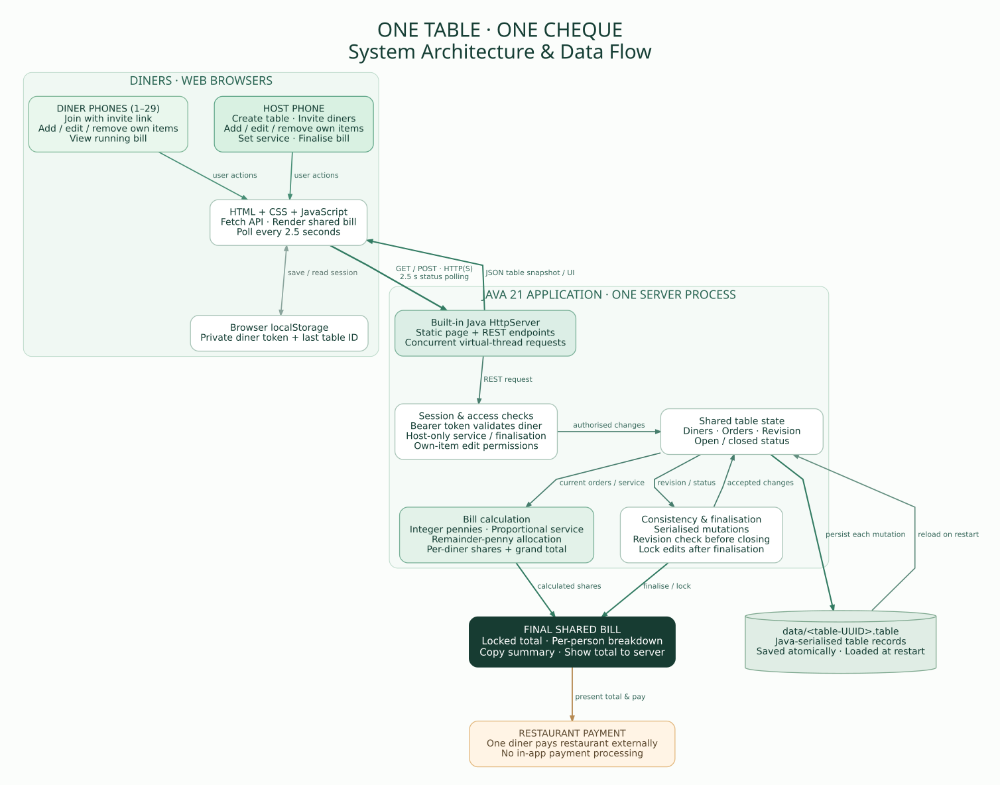

# One Cheque Live

One shared restaurant bill, with each diner adding their own orders from their phone.

### Tech Stack

| Component | Tech |
| --- | --- |
| Local Run | [](#run-locally) |
| Frontend |    |
| Backend |   |
| Storage |  |
| Container |  |
| Repo Size |  |

## System Architecture & Data Flow



## Run locally

From this folder, run with **Java 21**:

```bash
java src/OneCheque.java
```

Open [http://localhost:8080](http://localhost:8080). Java serves both the page and its API. There is no frontend build or dependency installation.

For a four-diner test on one computer, use four independent browser profiles or separate browsers. Tabs in the same profile share the saved diner session.

## Try it on four phones

1. Connect the computer running Java and the phones to the same Wi-Fi. The Java server listens on port 8080 on all network interfaces.
2. On the first phone, open `http://YOUR_COMPUTER_LAN_IP:8080`, using the computer's LAN address. On Ubuntu, `hostname -I` lists its addresses. Use the address on the Wi-Fi network.
3. Enter the host's name and create a table. Share the invite link with the other diners. Start from the LAN URL so the invite works from their phones.
4. Each diner opens the link, joins with their name, and adds a meal or drink. Use **Edit** to correct an item. Changes normally appear on the other phones within 2.5 seconds.
5. The host enters the restaurant's service charge if needed, compares the total to the restaurant bill, and taps **Finalise bill**. All phones can show the locked total and copy the breakdown. One diner pays the restaurant.

If phones can't reach the computer, check whether the host firewall allows inbound connections to port 8080 and whether the Wi-Fi isolates devices. Use a trusted network for this HTTP demo. On a LAN address, a browser may disable direct clipboard access. In that case the app opens a text box for manual copying.

## How it works

- The frontend uses HTML, CSS and JavaScript. Each table gets an invite link. Each browser gets a separate private diner token that it saves locally.
- The Java server checks the token on every bill request. A diner can change their own items. The host can set service and finalise the table. Anyone with the invite link can join an open table, so keep it within the group.
- Each mutation is applied to the latest state. The server uses a bill revision to reject checkout if someone changed the bill after the host reviewed it.
- All money is calculated in integer pennies. The app distributes leftover pennies in service-charge allocation so the diners' shares always add up to the table total.
- The backend saves each table in the `data/` directory and reloads it after restart. Keep that directory private and run one server process against it. Set `ONE_CHEQUE_DATA` to change the folder or `ONE_CHEQUE_PORT` to change the port.

This example uses Java's built-in HTTP server and file storage. An internet deployment would need HTTPS and a host that runs Java. For multiple server instances, replace file storage with a shared database such as PostgreSQL. The app calculates the bill and displays the final amount. Payment happens with the restaurant as usual.

## Verify

Run the API integration test with Python 3 and Java 21:

```bash
python3 test/live_test.py
```

The test launches a real Java server and uses four diner sessions to check concurrent orders, add retries, edit permissions, service-charge rounding, stale checkout, finalisation, and restart persistence.
